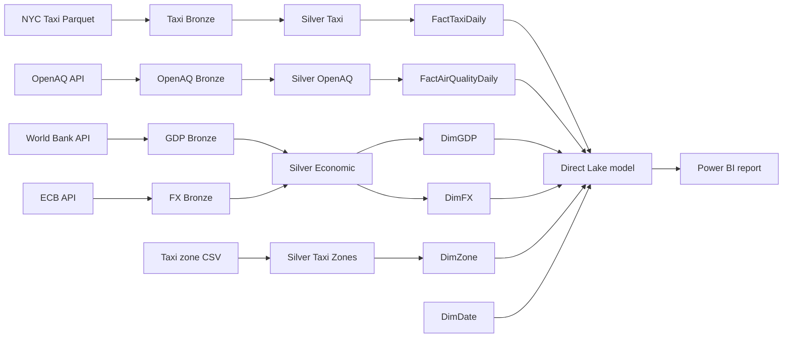

# NYC Taxi & Air Quality Analytics

This is my final Microsoft Fabric data engineering project. It combines NYC Yellow Taxi trips with air-quality, GDP and exchange-rate data.

I used a Bronze/Silver/Gold structure:

- Bronze keeps the source files and API results
- Silver contains cleaned Delta tables
- Gold is a star schema in Fabric Warehouse
- Power BI reads the Warehouse through a Direct Lake semantic model

## Questions covered by the project

The report was built to answer these questions:

1. How do daily Taxi trips compare with PM2.5 and NO2 levels?
2. Which Taxi zones and OpenAQ locations have the highest values?
3. What is the average revenue per trip in USD and EUR?
4. How do these results look together with GDP and FX data?

The Taxi and OpenAQ data can be compared by date. OpenAQ stations are not the same as NYC Taxi Zones, so I do not treat the comparison as a direct spatial or causal relationship.

## Data sources

| Data | Source | Loaded to Bronze |
|---|---|---|
| NYC Yellow Taxi trips | [NYC TLC Trip Records](https://www.nyc.gov/site/tlc/about/tlc-trip-record-data.page) | Monthly Parquet files in `Files/bronze/yellow_taxi/` |
| Taxi zones | [NYC TLC zone lookup](https://d37ci6vzurychx.cloudfront.net/misc/taxi_zone_lookup.csv) | `Files/bronze/reference/taxi_zone_lookup.csv` |
| Air quality | [OpenAQ API](https://docs.openaq.org/) | `bronze_openaq_locations` |
| USA GDP | [World Bank API](https://api.worldbank.org/v2/country/USA/indicator/NY.GDP.MKTP.CD?format=json) | `bronze_worldbank_gdp` |
| USD/EUR rate | [ECB Data API](https://data-api.ecb.europa.eu/service/data/EXR/D.USD.EUR.SP00.A?format=csvdata) | `bronze_ecb_fx_rates` |

## Data flow

A more detailed version is available in [docs/lineage.md](docs/lineage.md).

## Main Fabric items

| Item | What it does |
|---|---|
| `lh_nyc_taxi` | Stores Bronze files and Bronze/Silver Delta tables |
| `pl_nyc_taxi_ingestion` | Loads a Taxi month and runs the Taxi Silver notebook |
| `pl_openaq_ingestion` | Runs OpenAQ Bronze, Silver, Gold and freshness checks |
| `pl_master_orchestration` | Runs the full monthly process and Gold validation |
| `df_openaq_ingestion` | Gets OpenAQ data |
| `df_worldbank_ingestion` | Gets USA GDP data |
| `df_ecb_ingestion` | Gets daily USD/EUR rates |
| `nb_silver_taxi` | Cleans and standardizes Taxi trips |
| `nb_silver_openaq` | Cleans OpenAQ measurements |
| `nb_silver_economic` | Cleans GDP and FX data |
| `nb_reference_zones` | Loads the Taxi zone lookup |
| `wh_nyc_taxi_analytics` | Contains the Gold tables |
| `sm_nyc_taxi_analytics` | Contains relationships and DAX measures |

## Gold tables

- `FactTaxiDaily`
- `FactAirQualityDaily`
- `DimDate`
- `DimZone`
- `DimFX`
- `DimGDP`

Their fields and grains are listed in [docs/data-dictionary.md](docs/data-dictionary.md).

## Power BI pages

1. **Mobility Dashboard** — daily trips, average fare and busiest pickup zones.
2. **Air Quality** — PM2.5 and NO2 by date and monitoring location.
3. **Mobility vs Air Quality** — Taxi trips and PM2.5 on the same date axis.
4. **Economic Impact** — revenue in USD and EUR, GDP and average revenue per trip.

Taxi visuals use `ShowLoadedTaxiPeriod` because TLC data is normally published about two months later. The EUR calculations use the latest available ECB rate on or before the trip date.

## Schedules

| Pipeline | Schedule |
|---|---|
| `pl_openaq_ingestion` | Every day at 04:00 Central European time |
| `pl_master_orchestration` | Day 20 of every month at 06:00 Central European time |
| Standalone Taxi schedule | Disabled because Taxi already runs from the master pipeline |

The Taxi pipeline accepts `p_taxi_month` in `yyyy-MM` format. If it is empty, the pipeline uses the month from two months ago.

## Setup notes

Before the first run:

1. Configure the Fabric connections used by the pipelines and Dataflows.
2. Store the OpenAQ key in Azure Key Vault as `openaq-api-key`.
3. Upload `taxi_zone_lookup.csv` to `Files/bronze/reference/taxi_zone_lookup.csv`.
4. Run the master pipeline and check that `validate_gold` succeeds.

Full run instructions and SQL checks are in [docs/runbook.md](docs/runbook.md).

## Data checks

- Taxi rows with invalid dates, identifiers, amounts or distances are removed.
- Duplicate Taxi rows are removed in Silver.
- Invalid and negative OpenAQ values are removed.
- Gold tables are updated with `MERGE` statements.
- The OpenAQ pipeline checks freshness and compares the latest Silver and Gold dates.
- The master pipeline checks empty tables, duplicate keys and missing dates.

## Known limitations

- OpenAQ monitoring locations are not mapped to Taxi Zones.
- The Taxi/Air Quality chart shows a time comparison, not causation.
- Taxi files arrive approximately two months late.
- Taxi and OpenAQ have a shorter common history than GDP.
- Purview and RLS were optional in the task and were not added.

## Project documentation

- [Data dictionary](docs/data-dictionary.md)
- [Data lineage](docs/lineage.md)
- [Governance notes](docs/governance.md)
- [Runbook](docs/runbook.md)
- [Analytical findings](docs/analytical-findings.md)
