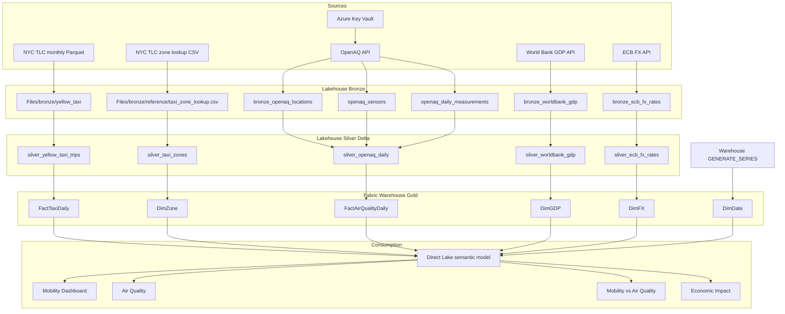

# Data Lineage

## End-to-end lineage

## Pipeline lineage

### Taxi

`pl_master_orchestration` → `pl_nyc_taxi_ingestion` → source-file metadata check → conditional TLC Parquet copy → `nb_silver_taxi` → `refresh_gold_taxi` → `FactTaxiDaily`.

The Taxi pipeline derives a default `p_taxi_month` equal to the month two months before execution. If the requested file already exists in Bronze, the copy is skipped and Silver processing continues. Historical months can be passed explicitly.

### OpenAQ

`pl_master_orchestration` or daily schedule → `pl_openaq_ingestion` → Key Vault `openaq-api-key` → `df_openaq_ingestion` → `bronze_openaq_locations`, `openaq_sensors`, and `openaq_daily_measurements` → `nb_silver_openaq` → `silver_openaq_daily` → full-history Gold `MERGE` → `FactAirQualityDaily` → `validate_openaq_freshness`.

### Economy

`pl_master_orchestration` starts `df_worldbank_ingestion` and `df_ecb_ingestion` in parallel. After both complete, `nb_silver_economic` produces standardized Silver tables. `refresh_gold_economic` merges the results into `DimGDP` and `DimFX`.

### Dimensions and validation

After the economic refresh, `nb_reference_zones` loads `silver_taxi_zones`. `refresh_gold_dimensions` generates `DimDate` independently with `GENERATE_SERIES` and updates `DimZone` from `silver_taxi_zones`. It is followed by `validate_gold`.

## Gold validation lineage

`validate_gold` fails the pipeline when required Gold objects are empty, duplicate Taxi or FX keys exist, or Taxi fact dates are absent from `DimDate`. The OpenAQ pipeline additionally fails when Silver/Gold are empty, Silver is stale by more than three days, or Gold does not include the latest Silver date.

## Consumption lineage

The semantic model uses Direct Lake over the Warehouse. `DimDate` filters both fact tables; `DimZone` filters Taxi. The correlation page aligns the facts by calendar date. Because OpenAQ monitoring locations are not mapped to TLC zones, spatial correlation is intentionally outside the current model.

